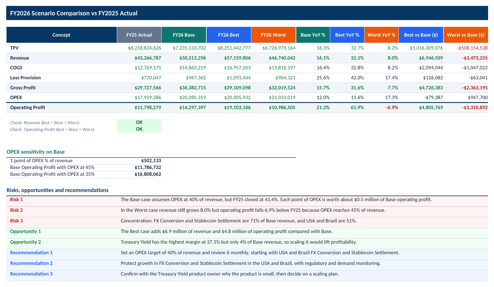
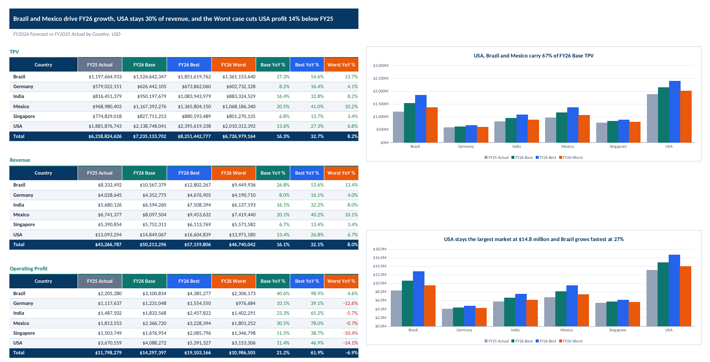

# FY2026 Scenario Forecast: SuperFintech Company

Capstone project of the IBM Financial Planning and Analysis (FP&A) with AI Skills specialization. It is an Excel model that forecasts FY2026 for a fictional fintech company under three scenarios: Base, Best and Worst.

## Scope

- 6 countries: Brazil, Germany, India, Mexico, Singapore and USA
- 5 products: Cross-border Payouts, FX Conversion, Stablecoin Settlement, Treasury Yield and Virtual Accounts
- Monthly detail, 360 rows per scenario

## How the model works

- Revenue = TPV x Take Rate
- Gross Profit = Revenue - COGS - Loss Provision
- Operating Profit = Gross Profit - OPEX
- FY26 TPV = FY25 monthly actual TPV x (1 + growth), with assumptions looked up by country and product using SUMIFS
- Best case: TPV growth at 2 times Base and OPEX at 35% of revenue
- Worst case: TPV growth at 0.5 times Base and OPEX at 45% of revenue

## Workbook tabs

- 2025 actual v budget: FY25 source data with totals
- Assumption-Base, Assumption-Best, Assumption-Worst: editable inputs per scenario
- Variance: FY25 actual vs budget, with the top favorable and unfavorable variances
- Forecast 26-Base, Forecast 26-Best, Forecast 26-Worst: monthly forecast by country and product
- Scenario Comparison: the three scenarios vs FY25, OPEX sensitivity, risks and recommendations
- Summary-Product and Summary-Country: summary tables, charts and executive summary
- Documentation: methodology, validation checks and conclusions

## Key results

| | FY25 Actual | FY26 Base | FY26 Best | FY26 Worst |
|---|---|---|---|---|
| Revenue | $43.3M | $50.2M | $57.2M | $46.7M |
| Operating Profit | $11.8M | $14.3M | $19.1M | $11.0M |

- Base grows revenue 16% and operating profit 21%.
- In the Worst case, operating profit falls 6.9% below FY25 because OPEX rises to 45% of revenue.
- Data quality finding: in the FY25 source data, Budget Gross Profit does not match Budget Revenue - Budget COGS - Budget Loss Provision. The gap is $525,868, about 1.3% of budget revenue.

## Use of AI

I built the model in Excel myself. An AI assistant gave step by step guidance, the formulas used in each tab and draft commentary for the variance analysis, scenario analysis and summary tabs. I reviewed the results against independent calculations.

## File

[Download the Excel workbook](https://github.com/Kenny-GomezCR/FPA-data-portfolio/raw/refs/heads/main/07-capstone-superfintech-forecast/FPA_FY2026_Scenario_Forecast.xlsx)

GitHub does not preview Excel files, so the link downloads the workbook. Open it in Excel to see the formulas and charts.

## Preview

